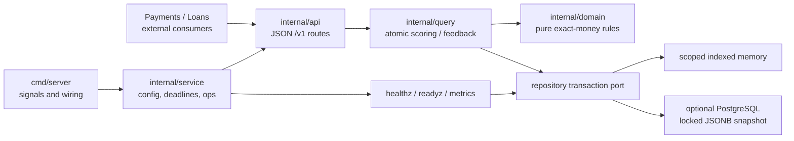

# Fraud detection: exact-money scoring with replay-safe decisions

A synthetic Go risk-scoring service for payments/loan consumers. It combines exact USD cents, weighted explainable rules, account-window history and deterministic feedback learning. A retried event keeps its original decision instead of contributing to velocity twice. **No real money, PII, credentials or fraud-detection accuracy claim.**

## Run locally

Go **1.27.1** was used for the measurements below; the module minimum is 1.25. From this clone, with Go on PATH:

```sh
GOTOOLCHAIN=local go mod download
DATABASE_URL= HTTP_ADDR=127.0.0.1:8103 GOTOOLCHAIN=local go run ./cmd/server
```

No database or Docker is needed in memory mode. Stop with Ctrl-C for graceful shutdown. Cold dependency downloads depend on network availability; no cold-clone two-minute timing is claimed. Memory mode loses decisions, feedback and learned thresholds at restart.

In another terminal:

```sh
curl -fsS http://localhost:8103/readyz
curl -sS -X POST http://localhost:8103/v1/score \
  -H 'Content-Type: application/json' \
  -d '{"event_id":"demo-allow","account":"synthetic-account","amount":"125.50","currency":"USD"}'
# {"event_id":"demo-allow","score":0,"decision":"ALLOW","reasons":[]}

# Identical retry returns the original result; changed payload is legacy HTTP 400.
curl -sS http://localhost:8103/v1/events/demo-allow/explanation
curl -sS http://localhost:8103/v1/rules
curl -i -X POST http://localhost:8103/v1/feedback \
  -H 'Content-Type: application/json' \
  -d '{"event_id":"demo-allow","label":"CONFIRMED_FRAUD"}'
# HTTP 202; identical feedback is a no-op, conflicting label is HTTP 400.
curl -sS http://localhost:8103/metrics
```

`event_id` is scoring's idempotency identity; there is no separate score idempotency-key header. Feedback identity is event/label: the same label does not adjust thresholds twice. A timeout can follow commit: retry the **same** event and payload, never invent a new identity.

## Architecture



CQRS-inspired layering, **not** separate read/write databases or independent read-model processes. Scoring intentionally coordinates a write transaction because its decision depends on committed account history. Fraud makes no downstream HTTP calls or cash postings, so a downstream outbox/retry/circuit-breaker is not applicable here. Cross-service S1/S2 load evidence belongs to the separate integration effort, not this repository's tests.

## Rules and contract

[OpenAPI](api/openapi.yaml) is authoritative. Domain routes: POST `/v1/score`, GET `/v1/events/{event_id}/explanation`, GET `/v1/rules`, POST `/v1/feedback`. All responses carry a server-generated `X-Request-ID`; errors use `{"error":{"code":"...","message":"..."},"request_id":"..."}`. Malformed inputs 400, missing explanation 404, cancellation 408, oversized body 413, recovered panic 500, unavailable store/outer response timeout 503. Legacy payload/feedback conflicts and missing feedback events remain **400, not 409/404**.

- Canonical amount is a decimal **string**, currency USD, at most two fractional digits, nonnegative and within int64 cents. Extra scale is rejected rather than rounded. Transitional JSON numeric tokens are parsed directly as text without float conversion; omitted currency defaults to USD for legacy callers.
- Default amount weights: over USD 5,000 adds 40; over USD 10,000 adds another 30. Default score bands: ALLOW below 40, REVIEW 40–69, DENY 70–100; score is capped at 100. These assume no additional signals/history and no learned threshold changes.
- Other named weights: ACCOUNT_VELOCITY 25 after five prior attempts, GEO_MISMATCH 20, DEVICE_MISMATCH 15, NEW_PAYEE 15, STRUCTURING 20. History counts unique scored attempts, including denials, in **(now-60s, now]**, per account; future timestamps after clock rollback do not count. Legacy `recent_count` may raise, never lower, the internal count.
- Structuring is inferred on the third same-account attempt when it and two prior amounts are within the inclusive top 10% of the configured band (default USD 900–1,000). The legacy supplied flag remains additive; false cannot suppress inference. This is a named synthetic heuristic, not a real-world compliance model.
- POST score emits **BLOCK**, the legacy alias of domain DENY; explanations return canonical DENY. Consumers must accept both. Score/explanation envelopes are snake_case; GET rules exposes all existing Go `RuleConfig` fields in PascalCase, with an explicit integer schema. Feedback202 has an empty body. Parsed tests exercise every declared v1 status against response schemas, including exact int64 policy serialization; this is a targeted response-checking subset, not a full OpenAPI/request validator.
- CONFIRMED_FRAUD lowers ReviewAt by one, FALSE_POSITIVE raises it by one, bounded by `[1,DenyAt]`. Existing decisions never change. Rule weights/thresholds can be injected through validated Go `RuleConfig` or the executable's strict `FRAUD_RULES_JSON` startup seed. There is no online admin write API. Feedback changes only ReviewAt; startup never resets an existing durable learned policy.

## Configuration and persistence

| Environment | Default | Validation / behavior |
| --- | --- | --- |
| `HTTP_ADDR` | `:8103` | host:port, nonzero port; use loopback for this unauthenticated demo |
| `DATABASE_URL` | empty | PostgreSQL URL selects durable store; do not log/commit connection information |
| `REQUEST_TIMEOUT` | `5s` | positive duration <=1m, including readiness |
| `STARTUP_TIMEOUT` | `10s` | positive <=1m, database startup |
| `SHUTDOWN_TIMEOUT` | `10s` | positive <=1m, then forced connection close |
| `FRAUD_RULES_JSON` | empty (defaults) | <=8192 raw bytes; strict PascalCase integer override object, new-store initialization only |
| `FRAUD_POSTGRES_CACHE` | temporary test directory | test-only embedded PostgreSQL archive cache |

Example startup override in memory mode (thresholds are integer **cents**):

```sh
DATABASE_URL= HTTP_ADDR=127.0.0.1:8103 GOTOOLCHAIN=local \
FRAUD_RULES_JSON='{"ReviewAt":20,"HighAmountCents":100,"VeryHighAmountCents":1000,"HighAmountWeight":20}' \
go run ./cmd/server
```

A fresh account's USD2.00 attempt now scores20/REVIEW instead of the default0/ALLOW. Empty/whitespace input or `{}` preserves defaults; partial objects overlay defaults. Unknown/wrong-case/duplicate keys, null, non-integer/fractional/exponent/overflow values, trailing JSON and invalid rule relationships fail startup without reflecting raw input. All canonical fields from GET rules are supported. Memory restart loses state and uses its new seed. **Existing PostgreSQL state wins in full:** valid changed/empty startup seeds never merge/reset learned rules, feedback or original event identities; invalid incoming or stored policy fails startup. Initialization commits before listening, so a subsequent listen failure does not undo a created durable row. See [startup semantics](docs/adr/005-startup-policy-seeding.md).

For PostgreSQL mode, supply a synthetic local PostgreSQL URL via the environment. The adapter initializes `fraud_state` idempotently and preserves existing learned state; the old `migrations/001_init.sql` is **not** its schema. Real embedded PostgreSQL 16.9 tests prove replay/feedback parity and state retained across database stop/start without Docker. Do not point this unauthenticated demo at production data.

Scoped memory avoids copying unrelated accounts but still copies retained account history under one mutex. Full memory Update and PostgreSQL load/copy full history; SQL uses one locked JSONB row and serializes readers/writers. Retention, indexed relational SQL scaling, production migration privileges, backup/restore and deployment recovery remain limitations. Durable storage is not a claim of scalable production readiness.

## Tests, measurements and what this demonstrates

```sh
export GOTOOLCHAIN=local
# Optional: reuse downloaded embedded PostgreSQL archives between test runs.
export FRAUD_POSTGRES_CACHE="${TMPDIR:-/tmp}/fraud-postgres-cache"
go build ./...
go vet ./...
test -z "$(gofmt -l .)"
go test -p 2 ./... -race -count=1 -coverprofile=coverage.out
go tool cover -func=coverage.out
bash scripts/check-coverage.sh coverage.out
go mod tidy
git diff --exit-code -- go.mod go.sum
# Separate optional fuzz / timing measurements:
go test ./internal/domain -run '^$' -fuzz '^FuzzStructuringBand$' -fuzztime=2s -parallel=2
go run ./cmd/latency -samples 10000 -raw
```

The SQL test **fails**, rather than skips, if its binary download/startup fails. It needs network on first use, an unprivileged user and a free ephemeral TCP port. The 2026-10-19 native repository suite, including actual SQL startup/restart, took 85.354s. Tests use injected clocks, channels and listeners rather than synchronization sleeps. The playback retry policy's timer is intentional backoff, not test synchronization.

Latest correctness run: 2026-10-19, parent `7c0b261`, Go 1.27.1 darwin/arm64. Timing/fuzz rows retain their separate 2026-10-18 `97c4c98` measurement (Apple M1 / 16 GiB); they were not rerun for this startup-policy card.

| Evidence | Result |
| --- | --- |
| Race tests | Passed, including actual PostgreSQL parity/restart |
| Statement coverage | domain100.0%, API96.0%, query95.9%, repository93.5%, service91.3%, playback61.5% |
| Weighted non-cmd coverage | **558/609 =91.63%**, not a mean of package percentages |
| Domain invariant evidence | **76/76 statements**, no uncovered blocks; every configured validation limit/relationship, exact money rejection/int64 boundaries, REVIEW/DENY boundaries and score/reason properties asserted |
| Structuring fuzz,2s (2026-10-18) | 145,053 executions; no failure |
| Memory application handler,10k unique isolated accounts (2026-10-18) | p50/p95/p99=1291/3292/5459ns |
| Exact replay cohort,10k calls (2026-10-18) | p50/p95/p99=1334/2750/4209ns |

Current startup-policy evidence: `ctl/logs/fraud/card9-gates.log` / `card9.cover`, including strict input rejection, configured HTTP scoring in both modes and actual SQL restart preserving learned rules under changed/empty seeds. All six previous uncovered domain blocks were reached with meaningful inputs; no production checks were removed or excluded. Statement100% is not a claim of exhaustive branch/input-space proof; unrelated service shutdown/error branches remain partially covered.

Timing excludes HTTP/network, caller payload construction and SQL. Both measured memory p99 values are below the 5ms in-process target; **this is not real-process10k S1 proof**. See [method/raw-evidence location](docs/performance.md), [acceptance status](openspec/dod.md), [glossary](docs/glossary.md) and [ADRs](docs/adr/). Immutable replay, exact money, scope rollback, concurrent velocity, inferred patterns and ambiguous-after-commit retries are the demonstrated engineering properties—not model accuracy or production certification.

A separate local warm-cache compiled-process smoke checked 12 HTTP operations (health/readiness, scoring/replay/explanation, feedback/rules/conflict, metrics) and SIGTERM exit 0; evidence is `ctl/logs/fraud/card6-gates.log`. It is not cold-clone timing, a SQL process drill or S1.

CI configuration is in [.github/workflows/ci.yml](.github/workflows/ci.yml), with tested weighted coverage gates. **UNVERIFIED: workflow not run.** Only native macOS results are recorded; Linux/Windows runtime behavior and Docker builds are not verified. Nothing has been pushed, tagged, published or deployed by this effort.
